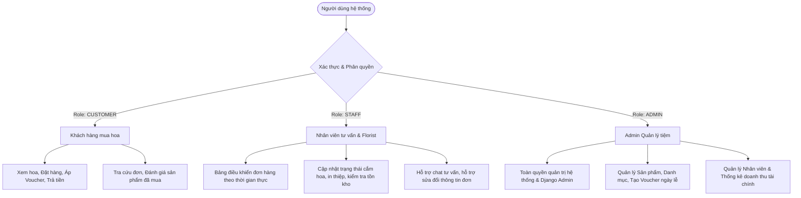
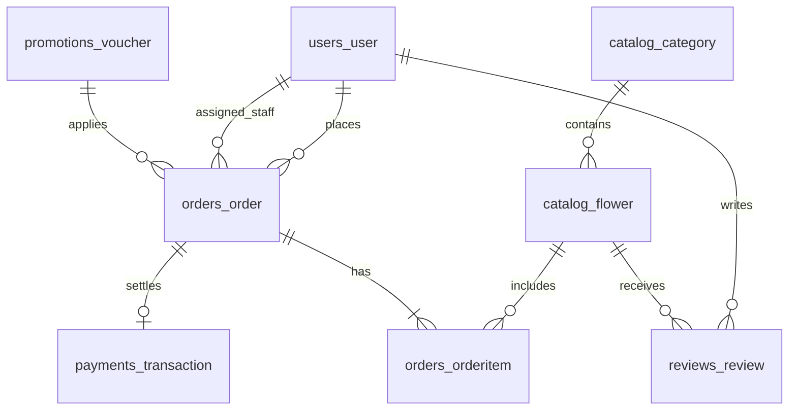
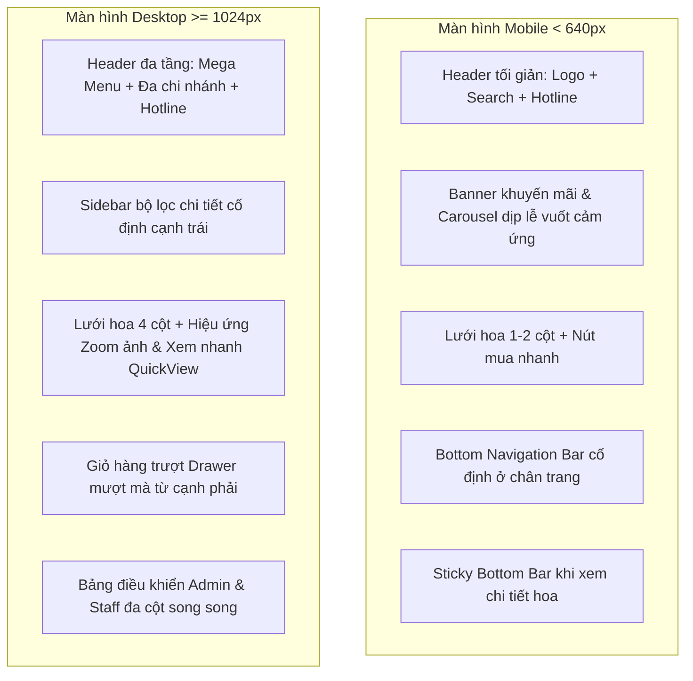

# LỘ TRÌNH CHI TIẾT PHÁT TRIỂN HỆ THỐNG WEBSITE HOA TƯƠI TRỰC TUYẾN
## DỰ ÁN: Rose Flowers (DJANGO REST FRAMEWORK & REACT TYPESCRIPT)

---

## 1. TỔNG QUAN HỆ THỐNG & CÔNG NGHỆ CHỦ ĐẠO

| Phân hệ | Công nghệ / Thư viện | Vai trò |
|---|---|---|
| **Backend** | Python 3.11+, Django 5.x, Django REST Framework (DRF) | Xây dựng RESTful API, Serializers, ViewSets, Database ORM, Quản trị Django Admin |
| **Phân quyền (RBAC)**| Custom DRF Permissions (`IsCustomer`, `IsStaffMember`, `IsAdminUser`) | **Phân quyền 3 vai trò:** Khách hàng (`CUSTOMER`), Nhân viên tư vấn (`STAFF`), Quản lý (`ADMIN`) |
| **Database** | PostgreSQL (Production) / SQLite (Local Dev) | Cơ sở dữ liệu quan hệ, tối ưu đánh chỉ mục (Indexing) cho User, Orders, Flowers |
| **Frontend Web** | React 19, TypeScript, Vite, Tailwind CSS v4, Motion | SPA giao diện tối giản sang trọng, hiệu ứng chuyển động mượt mà, type-safety |
| **State Management** | Redux Toolkit (hoặc Redux Core Store) | Quản lý trạng thái toàn cục: giỏ hàng, thông tin tài khoản & role, đơn hàng, voucher |
| **Navigation & Routing**| React Router DOM v7 (Web) & Kiến trúc React Navigation | Điều hướng khách hàng và phân chia Route Guards theo Role (`/admin/*`, `/staff/*`, `/*`) |
| **Xác thực (Auth)** | Google OAuth2 (Google Identity Services / Gmail), JWT | Đăng ký/đăng nhập nhanh bằng Gmail, cấp phát JWT mang thông tin `role` |
| **Cổng thanh toán** | VietQR (Napas 24/7), MoMo, VNPay, ZaloPay, COD | Thanh toán trực tuyến phổ biến tại Việt Nam, quét mã QR động |
| **Thông báo & Mail** | Gmail SMTP (Nodemailer / Django Mail), Web Push Notification | Gửi email biên lai tức thì, thông báo đẩy cập nhật trạng thái đơn hàng |
| **Tương tác đa kênh** | Google Maps API, Zalo OA / Chat Widget, Facebook Messenger, Hotline | Định vị chi nhánh, tính cước vận chuyển theo km, tư vấn trực tuyến |
| **Thiết kế Responsive**| Tailwind CSS v4 Breakpoints (`sm`, `md`, `lg`, `xl`, `2xl`) | **Chuẩn Mobile-First:** Tối ưu hóa 100% hiển thị trên Smartphone, Tablet, Laptop và Desktop |
| **Kiểm thử (Testing)** | Vitest / Jest (Frontend), Pytest / Django TestCase (Backend) | Kiểm thử đơn vị (Unit Tests) 100% các hàm nghiệp vụ và kiểm tra phân quyền RBAC |

---

## 2. MA TRẬN PHÂN QUYỀN 3 VAI TRÒ CHÍNH (ROLE-BASED ACCESS CONTROL - RBAC)

Hệ thống được thiết kế phân chia trách nhiệm rõ ràng giữa **3 nhóm người dùng**:



### 2.1. Chi tiết Trách nhiệm & Quyền hạn của từng Role:

#### 1. Khách hàng (`CUSTOMER`)
- **Đối tượng:** Khách mua hoa trực tuyến (đăng ký qua Gmail/Email hoặc khách vãng lai).
- **Quyền hạn & Chức năng:**
  - Duyệt bộ sưu tập hoa, tìm kiếm theo tên và ý nghĩa hoa, lọc theo khoảng giá và danh mục.
  - Quản lý giỏ hàng cá nhân, nhập mã voucher ngày lễ (8/3, 20/10, Valentine...) hoặc hưởng chiết khấu mua số lượng lớn.
  - Chọn vị trí giao hoa trên Google Maps và tự động nhận bảng cước phí giao hoa chính xác.
  - Chọn ngày, khung giờ giao hoa, viết lời chúc thiệp và ký tên người gửi.
  - Thanh toán bảo mật qua VietQR (Napas 24/7), Ví MoMo, VNPay, ZaloPay hoặc COD.
  - Nhận email xác nhận đơn hàng qua Gmail, nhận thông báo đẩy (Push Notifications) khi trạng thái đơn hàng thay đổi.
  - Đánh giá (1-5 sao) và để lại bình luận cho các sản phẩm hoa đã mua thành công (*Verified Buyer*).
  - Tra cứu và quản lý lịch sử đơn hàng cá nhân.

#### 2. Nhân viên tư vấn & Thợ cắm hoa (`STAFF`)
- **Đối tượng:** Đội ngũ chăm sóc khách hàng, nhân viên tư vấn bán hàng và florist cắm hoa tại tiệm.
- **Quyền hạn & Chức năng:**
  - **Bảng điều khiển tiếp nhận đơn hàng (Staff Order Kanban Board):** Theo dõi danh sách đơn hàng mới thời gian thực.
  - **Cập nhật tiến độ đơn hàng:** Chuyển trạng thái đơn: *Chờ xử lý* ➔ *Đang cắm hoa* ➔ *Đã bàn giao shipper* ➔ *Giao thành công*.
  - **In thiệp chúc mừng:** Xuất định dạng thiệp in sẵn lời chúc và chữ ký người gửi theo yêu cầu của khách.
  - **Tư vấn & Chăm sóc khách hàng:** Phản hồi khách hàng qua cửa sổ Chat trực tuyến, Zalo OA hoặc Hotline; hỗ trợ khách đổi địa chỉ giao, đổi khung giờ khi khách gọi hotline.
  - **Kiểm tra tình trạng hoa:** Xem số lượng tồn hoa theo ngày để kịp thời tư vấn cho khách nếu mẫu hoa chính bị hết.
  - **Giới hạn an toàn:** Không có quyền xóa sản phẩm khỏi hệ thống, không được xem báo cáo doanh thu tài chính tổng thể, không can thiệp vào tài khoản admin.

#### 3. Quản lý tiệm (`ADMIN`)
- **Đối tượng:** Chủ cửa hàng hoa, Giám đốc điều hành, Quản trị viên kỹ thuật.
- **Quyền hạn & Chức năng:**
  - **Toàn quyền hệ thống:** Truy cập toàn bộ giao diện quản trị Admin Web và Django Admin Suite.
  - **Quản lý danh mục & sản phẩm hoa:** Thêm mới, chỉnh sửa, xóa hoa, cấu hình các gói kích thước (Standard, Deluxe, Premium), quản lý thư viện ảnh gallery.
  - **Quản lý khuyến mãi & Voucher:** Tạo mã giảm giá ngày lễ đặc biệt, thiết lập điều kiện chiết khấu số lượng lớn, giới hạn số lượt dùng và thời hạn hiệu lực.
  - **Quản lý phân quyền & Nhân sự:** Tạo tài khoản nhân viên tư vấn (`STAFF`), cấp/thu hồi quyền truy cập, quản lý danh sách khách hàng.
  - **Báo cáo tài chính & Doanh thu:** Xem biểu đồ doanh thu theo ngày/tháng/năm, tỷ lệ các phương thức thanh toán, sản phẩm bán chạy nhất, chi phí vận chuyển.
  - **Kiểm duyệt đánh giá (Review Moderation):** Quản lý bình luận, ẩn các đánh giá spam hoặc vi phạm tiêu chuẩn cộng đồng.

---

### 2.2. Ma trận phân quyền API Endpoints (RBAC Permission Matrix):

| API Endpoint | Phương thức | `CUSTOMER` | `STAFF` | `ADMIN` |
|---|---|:---:|:---:|:---:|
| `/api/flowers/` (Danh sách & Chi tiết) | `GET` | ✅ Xem | ✅ Xem | ✅ Xem |
| `/api/flowers/` (Thêm / Sửa / Xóa hoa) | `POST`, `PUT`, `DELETE` | ❌ Cấm | ❌ Cấm | ✅ Toàn quyền |
| `/api/vouchers/validate/` | `POST` | ✅ Áp mã | ✅ Áp mã | ✅ Áp mã |
| `/api/vouchers/` (Tạo / Sửa / Xóa voucher) | `POST`, `PUT`, `DELETE` | ❌ Cấm | ❌ Cấm | ✅ Toàn quyền |
| `/api/orders/` (Tạo đơn hàng mới) | `POST` | ✅ Tạo đơn | ✅ Tạo hộ khách | ✅ Toàn quyền |
| `/api/orders/mine/` (Xem đơn của mình) | `GET` | ✅ Đơn cá nhân | ✅ Đơn cá nhân | ✅ Tất cả |
| `/api/orders/manage/` (Xem tất cả đơn hàng) | `GET` | ❌ Cấm | ✅ Xem điều phối | ✅ Toàn quyền |
| `/api/orders/{id}/status/` (Đổi trạng thái đơn) | `PATCH` | ❌ Cấm | ✅ Cập nhật tiến độ | ✅ Toàn quyền |
| `/api/reviews/` (Đăng bài đánh giá) | `POST` | ✅ Khi đã mua | ❌ Cấm | ✅ Quản trị |
| `/api/reviews/{id}/moderate/` | `PATCH`, `DELETE` | ❌ Cấm | ❌ Cấm | ✅ Duyệt / Ẩn |
| `/api/reports/financial/` (Báo cáo doanh thu) | `GET` | ❌ Cấm | ❌ Cấm | ✅ Toàn quyền |
| `/api/users/staff-management/` | `GET`, `POST`, `PUT` | ❌ Cấm | ❌ Cấm | ✅ Toàn quyền |

---

## 3. KIẾN TRÚC THƯ MỤC CHUẨN DOANH NGHIỆP

```text
RoseFlowerWeb/
├── backend/                      # PHÂN HỆ BACKEND (DJANGO REST FRAMEWORK)
│   ├── manage.py
│   ├── config/                   # Settings, urls chính, wsgi, asgi
│   │   ├── __init__.py
│   │   ├── settings.py
│   │   ├── urls.py
│   │   └── wsgi.py
│   ├── apps/
│   │   ├── accounts/             # Quản lý User, Google OAuth, Profile, RBAC
│   │   │   ├── models.py         # Custom User Model có trường `role` (Enum)
│   │   │   ├── permissions.py    # Custom DRF Permissions (IsCustomer, IsStaffMember, IsAdminUser)
│   │   │   ├── serializers.py
│   │   │   ├── views.py
│   │   │   └── urls.py
│   │   ├── catalog/              # Quản lý Hoa, Danh mục, Ý nghĩa hoa
│   │   │   ├── models.py
│   │   │   ├── serializers.py
│   │   │   ├── views.py
│   │   │   └── urls.py
│   │   ├── promotions/           # Voucher ngày lễ, chiết khấu số lượng lớn
│   │   │   ├── models.py
│   │   │   ├── serializers.py
│   │   │   ├── services.py       # Logic tính toán voucher
│   │   │   └── views.py
│   │   ├── orders/               # Đơn hàng, OrderItems, Tracking trạng thái
│   │   │   ├── models.py
│   │   │   ├── serializers.py
│   │   │   ├── views.py
│   │   │   └── urls.py
│   │   ├── payments/             # Tích hợp VietQR, MoMo, VNPay, ZaloPay
│   │   │   ├── gateways/         # Module kết nối từng cổng thanh toán
│   │   │   ├── models.py
│   │   │   ├── serializers.py
│   │   │   └── views.py
│   │   ├── reviews/              # Đánh giá & bình luận sản phẩm
│   │   │   ├── models.py
│   │   │   ├── serializers.py
│   │   │   └── views.py
│   │   └── notifications/        # Gửi Gmail SMTP, Push notification
│   │       ├── mail_service.py
│   │       └── push_service.py
│   └── tests/                    # Backend Unit Tests
│       ├── test_orders.py
│       ├── test_vouchers.py
│       ├── test_rbac_permissions.py
│       └── test_payments.py
│
├── frontend/                     # PHÂN HỆ FRONTEND (REACT + TYPESCRIPT + VITE)
│   ├── index.html
│   ├── vite.config.ts
│   ├── tsconfig.json
│   ├── package.json
│   └── src/
│       ├── assets/               # Hình ảnh hoa chất lượng cao, icons, banner
│       ├── components/           # Components chia nhỏ bài bản, tái sử dụng cao
│       │   ├── common/           # Button, Modal, Badge, RatingStars, Input
│       │   ├── layout/           # Header, Footer, Navbar, FloatingContact
│       │   ├── catalog/          # FlowerCard, FlowerGrid, FilterSidebar, SearchBar
│       │   ├── cart/             # CartDrawer, CartItem, QuantityStepper
│       │   ├── checkout/         # DeliveryForm, GoogleMapPicker, PaymentMethodSelector
│       │   ├── reviews/          # ReviewList, ReviewForm, StarRating
│       │   ├── vouchers/         # VoucherBadge, VoucherModal, PromoBanner
│       │   ├── tracking/         # OrderStatusTimeline, PushNotificationToggle
│       │   ├── staff/            # GIAO DIỆN DÀNH CHO NHÂN VIÊN TƯ VẤN
│       │   │   ├── StaffOrderBoard.tsx     # Bảng Kanban theo dõi đơn hàng
│       │   │   ├── PrintCardModal.tsx      # Modal xuất in thiệp chúc mừng
│       │   │   ├── OrderStatusUpdater.tsx  # Cập nhật nhanh trạng thái cắm hoa
│       │   │   └── CustomerChatDrawer.tsx  # Hỗ trợ tư vấn khách hàng
│       │   └── admin/            # GIAO DIỆN DÀNH CHO ADMIN QUẢN LÝ TIỆM
│       │       ├── AdminDashboard.tsx      # Thống kê tổng quan doanh thu & đơn
│       │       ├── FlowerManager.tsx       # Thêm/sửa/xóa sản phẩm hoa
│       │       ├── VoucherManager.tsx      # Tạo voucher ngày lễ & chiết khấu
│       │       ├── UserRoleManager.tsx     # Quản lý tài khoản & phân quyền nhân viên
│       │       └── ReviewModerator.tsx     # Duyệt & xử lý bình luận
│       ├── routes/               # Routing & Role-Based Protected Routes
│       │   ├── AppRoutes.tsx
│       │   └── ProtectedRoute.tsx # Kiểm tra quyền (CUSTOMER, STAFF, ADMIN)
│       ├── services/             # Giao tiếp HTTP REST API (ES6 async/await)
│       │   ├── api.ts            # Client Axios/Fetch tập trung, tự động gắn JWT
│       │   ├── flowerService.ts
│       │   ├── orderService.ts
│       │   ├── paymentService.ts # Tạo mã VietQR động, redirect cổng ví
│       │   ├── authService.ts    # Google OAuth token exchange & JWT decode
│       │   └── mapService.ts     # Tính khoảng cách & cước phí vận chuyển
│       ├── store/                # Quản lý State toàn cục (Redux Toolkit)
│       │   ├── index.ts          # Root Store
│       │   ├── slices/
│       │   │   ├── cartSlice.ts
│       │   │   ├── authSlice.ts  # Quản lý user, token & currentUser.role
│       │   │   ├── orderSlice.ts
│       │   │   └── notificationSlice.ts
│       │   └── hooks.ts          # Typed useAppDispatch, useAppSelector
│       ├── types/                # TypeScript Interfaces & Types an toàn dữ liệu
│       │   └── index.ts
│       ├── utils/                # Hàm thuần (pure functions) xử lý tính toán
│       │   ├── currency.ts       # Format tiền tệ VND chuẩn
│       │   ├── shipping.ts       # Công thức cước km Google Maps
│       │   └── discounts.ts      # Tính chiết khấu đơn lớn & mã lễ
│       └── tests/                # Bộ kiểm thử đơn vị Unit Tests
│           ├── discounts.test.ts
│           ├── shipping.test.ts
│           ├── rbac.test.ts
│           └── cart.test.ts
│
├── REQUIREMENTS_SPEC.md          # Tài liệu đặc tả kỹ thuật chi tiết
└── ROADMAP_IMPLEMENTATION.md     # Bản lộ trình này
```

---

## 4. THIẾT KẾ CƠ SỞ DỮ LIỆU TỐI ƯU TRUY VẤN (DATABASE SCHEMA)

Thiết kế relational database chuẩn hóa 3NF, đánh chỉ mục (`db_index=True`) tại các trường thường xuyên tìm kiếm, lọc và kết nối khóa ngoại:



### Các bảng dữ liệu chính & Cấu trúc tối ưu:
1. **`users_user` (Người dùng & Phân quyền)**:
   - `id` (UUID, Primary Key).
   - `email` (Varchar 255, Indexed, Unique).
   - `role` (Enum: `CUSTOMER`, `STAFF`, `ADMIN`, Default: `CUSTOMER`, Indexed).
   - `full_name` (Varchar 150).
   - `phone_number` (Varchar 20, Indexed).
   - `avatar_url` (Varchar 500).
   - `is_active` (Boolean, Default True).
   - `date_joined` (Timestamp).
   - *Tối ưu:* Đánh index `email` và `role` để định danh và phân quyền với tốc độ `O(1)`.

2. **`catalog_flower` (Sản phẩm hoa tươi)**:
   - `id` (Slug/Indexed), `name` (Indexed), `botanical_name`, `category_id` (ForeignKey), `base_price` (Indexed), `sale_price`, `image_url`, `gallery` (JSON), `short_description`, `meaning`, `occasions` (JSON), `is_featured`, `is_in_stock`.
   - *Tối ưu:* Composite index `(category_id, is_in_stock, base_price)` giúp lọc hoa theo danh mục và khoảng giá siêu tốc.

3. **`promotions_voucher` (Mã giảm giá & Khuyến mãi)**:
   - `code` (Unique, Indexed), `discount_type` (`PERCENT`/`FIXED`), `discount_value`, `min_order_value`, `min_quantity` (cho đơn lớn), `is_holiday_special` (ngày lễ: 8/3, 20/10, Valentine, 20/11), `valid_from`, `valid_to`, `usage_limit`.

4. **`orders_order` (Đơn hàng)**:
   - `id` (Varchar, Indexed), `user_id` (ForeignKey Nullable cho khách vãng lai).
   - `assigned_staff_id` (ForeignKey -> `users_user.id`, Nullable - Nhân viên tư vấn phụ trách).
   - `customer_name`, `customer_phone` (Indexed), `customer_email`, `shipping_address`, `distance_km`, `shipping_fee`, `subtotal`, `discount_amount`, `total_amount`.
   - `status` (Enum: `PENDING`, `ARRANGING`, `SHIPPING`, `DELIVERED`, `CANCELLED`, Indexed).
   - `greeting_message` (Lời chúc thiệp), `sender_signature` (Chữ ký người gửi), `created_at` (Indexed).
   - *Tối ưu:* Đánh index `(user_id, created_at)` và `(status, created_at)` cho bảng Kanban của nhân viên tư vấn.

5. **`orders_orderitem` (Chi tiết đơn hàng)**:
   - `order_id` (ForeignKey, on_delete=CASCADE), `flower_id` (ForeignKey), `size_variant` (`STANDARD`/`DELUXE`/`PREMIUM`), `unit_price`, `quantity`, `total_price`.

6. **`payments_transaction` (Giao dịch thanh toán)**:
   - `order_id` (ForeignKey), `method` (`VIETQR`, `MOMO`, `VNPAY`, `ZALOPAY`, `COD`), `amount`, `status` (`PENDING`, `SUCCESS`, `FAILED`), `transaction_code` (Indexed), `paid_at`.

7. **`reviews_review` (Đánh giá & Bình luận)**:
   - `flower_id` (ForeignKey, Indexed), `user_id` (ForeignKey), `rating` (1-5 sao), `comment`, `is_verified_buyer` (True nếu đã mua đơn thành công), `is_approved` (Boolean cho kiểm duyệt admin).

---

## 5. LỘ TRÌNH 7 GIAI ĐOẠN TRIỂN KHAI CHI TIẾT (STEP-BY-STEP ROADMAP)

### GIAI ĐOẠN 1: KHỞI TẠO MÔI TRƯỜNG, DATABASE & PHÂN QUYỀN RBAC (Tuần 1)
- [ ] **1.1. Thiết lập Backend Django Rest Framework & RBAC**:
  - Khởi tạo virtual environment Python 3.11+, cài đặt `django`, `djangorestframework`, `django-cors-headers`, `psycopg2-binary`, `python-dotenv`.
  - Cấu hình file `settings.py`: CORS policy cho phép kết nối từ Vite dev server (`http://localhost:3000`), múi giờ `Asia/Ho_Chi_Minh`.
  - Định nghĩa Custom User Model với trường `role` (CUSTOMER, STAFF, ADMIN).
  - Viết Custom DRF Permissions: `IsCustomer`, `IsStaffMember`, `IsAdminUser`.
- [ ] **1.2. Chuẩn hóa Frontend React 19 + TypeScript + Vite**:
  - Cấu hình `vite.config.ts` với `@tailwindcss/vite`, alias `@` trỏ vào thư mục nguồn.
  - Cài đặt: `motion` (animation), `lucide-react` (icons), `canvas-confetti`.
  - Thiết lập Redux Toolkit (`authSlice`, `cartSlice`) với kiểu dữ liệu `Role` trong TypeScript.
  - Cấu hình Route Guards (`ProtectedRoute`) bảo vệ các trang quản lý theo Role.

---

### GIAI ĐOẠN 2: CATALOG HOA & BỘ LỌC TỐI ƯU (Tuần 2)
- [ ] **2.1. Xây dựng Django Models & Serializers cho Catalog**:
  - Tạo `Category` và `Flower` model với đầy đủ trường: giá gốc, giá sale, gallery ảnh, ý nghĩa hoa, dịp tặng.
  - ViewSet hỗ trợ `SearchFilter` (tìm kiếm theo tên, ý nghĩa hoa) và `OrderingFilter`.
  - Phân quyền: Mọi người dùng xem được hoa; chỉ `ADMIN` mới được thêm/sửa/xóa hoa.
- [ ] **2.2. Frontend: Giao diện Bộ sưu tập Tối giản & Sang trọng**:
  - Xây dựng component `FlowerCard` hiệu ứng hover mượt mà (`motion.div`), tag giảm giá, nút thêm nhanh.
  - Xây dựng `FilterBar`: lọc theo danh mục, khoảng giá, dịp tặng (Sinh nhật, Khai trương, Tình yêu...).
  - Kết nối gọi API bất đồng bộ (async/await) và Skeleton loading mượt mà.

---

### GIAI ĐOẠN 3: GIỎ HÀNG, CHIẾT KHẤU ĐƠN LỚN & VOUCHER DỊP LỄ (Tuần 3)
- [ ] **3.1. Logic Khuyến mãi & Voucher**:
  - **Chiết khấu đơn lớn (Bulk Order Discount)**: Tự động giảm 5% khi mua >= 3 bó, giảm 10% khi mua >= 5 bó hoặc đơn trên 2.000.000đ.
  - **Mã Voucher ngày lễ đặc biệt (Holiday Specials)**: Validate mã dành riêng cho 8/3 (`WOMENSDAY`), 20/10 (`VIETNAMWOMEN`), Valentine 14/2 (`VALENTINE`), Ngày Nhà Giáo (`TEACHER`).
  - Viết API `POST /api/vouchers/validate/`.
  - Phân quyền: `ADMIN` tạo và chỉnh sửa voucher; `CUSTOMER` và `STAFF` áp dụng mã.
- [ ] **3.2. Redux State Giỏ hàng (Cart Store)**:
  - Viết `cartSlice.ts`: quản lý `items`, tự động tính toán `subtotal`, `discountAmount`, `finalTotal`.
  - Đồng bộ `localStorage` và giao diện giỏ hàng dạng trượt (Drawer Sidebar) mượt mà.

---

### GIAI ĐOẠN 4: ĐẶT HÀNG, GOOGLE MAPS & TƯƠNG TÁC ĐA KÊNH (Tuần 4)
- [ ] **4.1. Tích hợp Google Maps & Tự động tính cước giao hoa**:
  - Tích hợp Google Maps Geocoding & Distance Matrix API: Tự động đo khoảng cách từ tiệm hoa đến vị trí khách nhận.
  - Tự động áp cước: Miễn phí < 3km; 3-10km tính 5.000đ/km; > 10km tính cước bảo quản hỏa tốc.
- [ ] **4.2. Form thông tin đặt hoa & In thiệp**:
  - Nhập thông tin người gửi & người nhận, ngày & khung giờ giao hoa.
  - Lời chúc thiệp đính kèm và chữ ký người gửi (chuẩn bị dữ liệu cho nhân viên in thiệp).
- [ ] **4.3. Nút tương tác đa kênh nổi (Floating Contact Bar)**:
  - Widget liên kết nhanh: **Zalo OA Chat**, **Facebook Messenger**, **Hotline gọi ngay**, **Google Maps dẫn đường**.

---

### GIAI ĐOẠN 5: CỔNG THANH TOÁN VIỆT NAM BẢO MẬT (Tuần 5)
- [ ] **5.1. VietQR (Napas 24/7 Chuẩn ngân hàng)**:
  - Backend sinh mã VietQR chuẩn Napas với: Mã ngân hàng (MB Bank - 970422), STK tiệm hoa, số tiền chính xác, nội dung `HOA {MA_DON}`.
  - Frontend hiển thị modal QR động kèm nút sao chép STK và nội dung.
  - Webhook đối soát biến động số dư tự động chuyển trạng thái đơn sang `ĐÃ THANH TOÁN`.
- [ ] **5.2. Cổng MoMo, VNPay, ZaloPay & COD**:
  - Xây dựng endpoint `POST /api/payments/create-intent/` bảo mật HMAC-SHA256.
  - Callback/IPN handler xác thực kết quả thanh toán.
  - Hỗ trợ thanh toán COD khi nhận hoa.

---

### GIAI ĐOẠN 6: GIAO DIỆN PHÂN QUYỀN (STAFF & ADMIN) + EMAIL & PUSH (Tuần 6)
- [ ] **6.1. Giao diện Dành cho Nhân viên tư vấn (`STAFF`)**:
  - Xây dựng **Bảng Kanban đơn hàng (`StaffOrderBoard.tsx`)**: Kéo thả / click đổi trạng thái đơn (*Chờ xử lý* ➔ *Đang cắm hoa* ➔ *Đang giao* ➔ *Đã giao*).
  - Component **In thiệp chúc mừng (`PrintCardModal.tsx`)**: In trực tiếp lời chúc thiệp định dạng trang nhã.
  - Khung tư vấn và hỗ trợ khách qua chat trực tuyến (`CustomerChatDrawer.tsx`).
- [ ] **6.2. Giao diện Dành cho Quản lý tiệm (`ADMIN`)**:
  - Xây dựng **Admin Dashboard (`AdminDashboard.tsx`)**: Biểu đồ doanh thu tài chính, thống kê đơn hàng.
  - Quản lý sản phẩm hoa (`FlowerManager.tsx`), tạo mã voucher ngày lễ (`VoucherManager.tsx`).
  - Quản lý tài khoản & phân quyền nhân viên (`UserRoleManager.tsx`).
- [ ] **6.3. Xác thực Gmail & Thông báo**:
  - Đăng nhập/Đăng ký một chạm với Gmail (Google OAuth2).
  - Gửi email xác nhận đơn hàng chuyên nghiệp qua Gmail SMTP.
  - Web Push Notification cập nhật trạng thái đơn hàng thời gian thực cho khách.
- [ ] **6.4. Đánh giá & Bình luận (Verified Reviews)**:
  - Khách hàng đã nhận đơn đánh giá 1-5 sao; Admin có quyền kiểm duyệt/ẩn bình luận.

---

### GIAI ĐOẠN 7: KIỂM THỬ ĐƠN VỊ TOÀN DIỆN & TRIỂN KHAI (Tuần 7)
- [ ] **7.1. Bộ Kiểm thử Đơn vị Frontend (Vitest / Jest)**:
  - `testCalculateCartSubtotal`: Đảm bảo tổng tiền luôn chính xác theo số lượng.
  - `testApplyBulkOrderDiscount`: Đảm bảo chiết khấu đơn hàng lớn chính xác.
  - `testHolidayVoucherValidation`: Đảm bảo kiểm tra đúng voucher ngày lễ 8/3, 20/10, Valentine.
  - `testShippingFeeByDistance`: Đảm bảo cước giao hoa tính chính xác theo km.
  - `testFormatVND`: Đảm bảo format tiền tệ tiếng Việt chuẩn.
  - `testRoleGuardAccess`: Đảm bảo chặn người dùng thường truy cập trang Staff/Admin.
- [ ] **7.2. Bộ Kiểm thử Backend (Pytest / Django TestCase)**:
  - Test tính toàn vẹn dữ liệu khi tạo Order và OrderItems.
  - Test Custom DRF Permissions (Staff không được xóa hoa hoặc xem báo cáo tài chính).
  - Test xử lý chữ ký Webhook thanh toán bảo mật.
- [ ] **7.3. Triển khai Production**:
  - Build Frontend với `npm run build` tối ưu bundle size và lazy loading ảnh.
  - Triển khai Backend với Gunicorn, Nginx, PostgreSQL, cấu hình SSL/TLS HTTPS.

---

## 6. QUY CHUẨN VIẾT CODE & NGUYÊN TẮC PHÁT TRIỂN

1. **Clean Code & Đặt tên tường minh**:
   - Tên biến, hàm, component rõ nghĩa (`calculateShippingFee`, `isVerifiedBuyer`, `StaffOrderBoard`).
   - Chỉ comment khi cần thiết để giải thích thuật ngữ hoặc logic nghiệp vụ phức tạp.
2. **Type Safety với TypeScript**:
   - 100% dữ liệu (User, Role, Flower, Order, Voucher) đều có kiểu dữ liệu mạnh; nghiêm cấm kiểu `any`.
3. **Hiệu ứng chuyển động (Micro-interactions)**:
   - Sử dụng thư viện `motion` cho hiệu ứng fade, trượt và hover tinh tế, tạo trải nghiệm sang trọng.
4. **Bảo mật tuyệt đối**:
   - Token JWT được bảo vệ an toàn, phân quyền chặt chẽ ở cả Frontend (Route Guard) và Backend (DRF Permissions).
5. **Tiêu chuẩn Responsive bắt buộc**:
   - Mọi component tạo mới bắt buộc phải được kiểm tra hiển thị trên Mobile (`w < 640px`), Tablet (`640px <= w < 1024px`) và Desktop (`w >= 1024px`). Không được để xuất hiện thanh cuộn ngang ngoài ý muốn (Horizontal overflow scroll).

---

## 7. TIÊU CHUẨN THIẾT KẾ ĐÁP ỨNG TOÀN DIỆN (RESPONSIVE & MOBILE-FIRST SYSTEM)

Do đặc thù ngành hoa tươi và quà tặng có **hơn 75% lưu lượng truy cập đặt hoa đến từ thiết bị di động (Smartphone)**, toàn bộ hệ thống áp dụng triệt để chiến lược **Mobile-First**.

### 7.1. Bảng phân phối Breakpoints chuẩn Tailwind CSS:

| Breakpoint | Kích thước màn hình | Thiết bị đại diện | Bố cục & Trải nghiệm tương tác |
|---|---|---|---|
| **`xs` / Mobile** | `< 640px` | iPhone, Samsung Galaxy | 1 cột (hoặc lưới 2 cột nhỏ), thanh điều hướng đáy (Bottom Nav), chạm ngón cái tiện lợi |
| **`sm` / Phablet** | `640px - 767px` | Màn hình gập, điện thoại lớn | Lưới 2 cột cho danh sách hoa, modal căn giữa màn hình |
| **`md` / Tablet** | `768px - 1023px` | iPad mini, iPad 10.2", Galaxy Tab | Lưới 2-3 cột, menu thu gọn (Drawer/Off-canvas), Kanban cuộn ngang cảm ứng |
| **`lg` / Laptop** | `1024px - 1279px` | Macbook Air 13", ThinkPad | Lưới 3-4 cột, Sidebar bộ lọc cố định bên trái, Header đầy đủ tính năng |
| **`xl` / Desktop** | `1280px - 1535px` | iMac 24", Màn hình 27" Full HD | Lưới 4 cột, giới hạn chiều rộng nội dung tối đa `max-w-7xl mx-auto` |
| **`2xl` / Màn lớn** | `>= 1536px` | Màn hình Ultra-wide, 2K/4K | Giữ tỷ lệ cân đối, khoảng đệm an toàn, không bị tràn dãn giao diện |

---

### 7.2. Quy chuẩn Responsive chi tiết cho từng Phân hệ & Component:



#### 1. Header & Điều hướng (Navigation):
- **Trên Mobile (`< 768px`):**
  - Header thu gọn tối giản: Logo tiệm hoa, nút tìm kiếm nhanh và nút mở giỏ hàng.
  - Sử dụng **Thanh điều hướng đáy (Bottom Navigation Bar)** cố định ở chân màn hình gồm 5 nút: *Trang chủ*, *Danh mục*, *Giỏ hàng (kèm huy hiệu số lượng hoa)*, *Tra cứu đơn*, *Tài khoản cá nhân*.
  - Thanh liên hệ nổi đa kênh (Zalo, Messenger, Gọi điện) tự động thu thành 1 nút tròn nổi duy nhất (Floating Action Button - FAB) để không che khuất nội dung trang.
- **Trên Desktop (`>= 768px`):**
  - Header mở rộng đầy đủ các menu: *Bộ sưu tập hoa*, *Hoa sinh nhật*, *Hoa khai trương*, *Hoa sáp*, *Dịp lễ 8/3 - 20/10*, *Hệ thống chi nhánh*, *Hotline tư vấn*.

#### 2. Danh sách Sản phẩm hoa (`FlowerGrid` & `FlowerCard`):
- **Mobile (`< 640px`):** Grid 1 cột (dạng thẻ ngang) hoặc 2 cột nhỏ (`grid-cols-2 gap-3`); hình ảnh hoa vuông tỷ lệ `1:1`; kích thước nút bấm tối thiểu **44x44px** đảm bảo chuẩn tiếp xúc ngón tay.
- **Tablet (`640px - 1024px`):** Grid 2 đến 3 cột (`grid-cols-2 md:grid-cols-3 gap-5`).
- **Desktop (`>= 1024px`):** Grid 4 cột (`lg:grid-cols-4 gap-6`); tích hợp hiệu ứng hover lướt ảnh sang trọng và nút *Xem nhanh (Quick View)*.

#### 3. Giỏ hàng & Thanh toán (Cart & Checkout):
- **Mobile:**
  - Drawer giỏ hàng trượt từ đáy lên (Bottom Sheet) hoặc toàn màn hình.
  - Form đặt hàng tối ưu tự động thu phóng (viewport `width=device-width, initial-scale=1.0, maximum-scale=1.0`) không bị vỡ bố cục khi bàn phím ảo bật lên.
  - Bản đồ Google Maps chọn vị trí giao hoa tự động hiển thị dạng modal chiếm 90% chiều cao màn hình.
  - Mã VietQR tự động co giãn vừa vặn màn hình điện thoại, có nút 1-chạm sao chép STK và mở ứng dụng ngân hàng.
- **Desktop:**
  - Drawer trượt từ mép phải (`w-[420px]`).
  - Trang Checkout chia làm 2 cột: Cột trái nhập thông tin người gửi/nhận & bản đồ, Cột phải cố định tóm tắt đơn hàng và thanh toán.

#### 4. Giao diện Nhân viên tư vấn (`STAFF`) & Quản lý (`ADMIN`):
- **Bảng Kanban đơn hàng (`StaffOrderBoard.tsx`):**
  - Trên Mobile/Tablet: Cho phép vuốt ngang cảm ứng (horizontal swipe) để chuyển đổi giữa các cột *Chờ xử lý* ➔ *Đang cắm hoa* ➔ *Đang giao* ➔ *Đã giao*.
  - Trên Desktop: Hiển thị đầy đủ tất cả các cột trạng thái song song để nhân viên quan sát toàn bộ tiến độ cùng lúc.
- **Admin Dashboard (`AdminDashboard.tsx`):**
  - Biểu đồ tài chính tự động điều chỉnh kích thước (`ResponsiveContainer` trong thư viện biểu đồ) để không bị tràn viền trên màn hình nhỏ.

---

### 7.3. Checklist Kiểm thử Đáp ứng (Responsive QA Matrix):
- [ ] Kiểm tra giao diện trên **iPhone SE / iPhone 13/14/15/16 Pro Max** (Safari & Chrome iOS).
- [ ] Kiểm tra giao diện trên **Samsung Galaxy / Google Pixel** (Chrome Android).
- [ ] Kiểm tra giao diện trên **iPad Air / iPad Pro 11" & 12.9"** (Chế độ dọc & ngang).
- [ ] Kiểm tra trên **Laptop 13 inch - 15 inch** (Độ phân giải 1366x768, 1440x900, 1920x1080).
- [ ] Kiểm tra trên **Màn hình lớn 2K/4K** (Đảm bảo container căn giữa đẹp mắt, không kéo dãn hình ảnh hoa).
- [ ] Đảm bảo **100% không có thanh cuộn ngang vô ý (No unwanted horizontal scroll)** ở bất kỳ trang nào.

